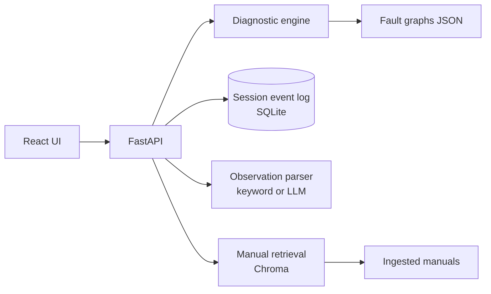

# Roota

[](https://github.com/mmk4567890/roota/actions/workflows/ci.yml)

Stateful fault isolation for industrial variable-frequency drives.

## Why

Technicians diagnose drive faults from long PDF manuals. Roota walks them through the documented checks one at a time, updates what is known from their answers, and cites the manual page for every recommendation — so the next step is always grounded in the procedure, not guesswork.

## Screenshots


## Architecture



Design decisions:

- The diagnostic engine is deterministic and separate from the language parser — the parser only translates technician wording into field values.
- Sessions are event-sourced (append-only SQLite log) with undo; current state is always replayed.
- Causes can be confirmed, ruled out, open, or inconclusive when checks finish without a clear outcome.
- Every check and corrective action carries a manual citation (`doc_id`, section, page).
- The default keyword parser runs fully offline; the Anthropic parser is optional.
- [Known open questions about the manual](docs/OPEN_QUESTIONS.md), recorded on each cause in the graph.

## Quick start

**Docker Compose** (fastest):

```bash
docker compose up
```

Open http://localhost:5173. The backend runs with the offline keyword parser; sessions and the ingested manual are kept in the `roota-data` volume. Citations need the manual: see [Getting the manual](#getting-the-manual) for the ingest command inside the container.

### Manual setup

**Backend** (Python 3.11+):

```bash
cd backend
python -m venv .venv
# Windows: .venv\Scripts\activate
# macOS / Linux: source .venv/bin/activate
pip install -r requirements.txt
uvicorn app.main:app --reload --port 8000
```

**Frontend** (Node 20+):

```bash
cd frontend
npm install
npm run dev
```

Open the Vite URL (typically http://localhost:5173). API docs: http://localhost:8000/api/docs.

Copy `.env.example` for optional settings (`ROOTA_PARSER=keyword` by default).

## Getting the manual

The ABB ACS580 firmware manual (document **3AXD50000016097**, Rev J) is not included for copyright reasons. Download it from [ABB's library](https://library.abb.com/), place the PDF in `docs/manuals/`, then from `backend/`:

```bash
python -m app.retrieval.prefetch
python -m app.retrieval.ingest ../docs/manuals/<file>.pdf --doc-id abb_acs580_fw --title "ABB ACS580 firmware manual"
python scripts/check_citations.py
```

With Docker Compose, `docs/manuals/` is mounted into the backend container, so with the stack running:

```bash
docker compose exec backend python -m app.retrieval.ingest ../docs/manuals/<file>.pdf --doc-id abb_acs580_fw --title "ABB ACS580 firmware manual"
```

```bash
docker compose exec backend python scripts/check_citations.py
```

The embedding model is already in the image, so no prefetch step is needed there.

Without the manual Roota still runs, but recommendations show no cited passages.

## Try it

Start a session for **ABB ACS580 drive overtemperature**, then type observations such as:

1. `The cooling fan is not running.` → root cause: cooling fan failure.
2. `Fan is spinning fine but the vents are packed with dust.` → continues; then `Heatsink fins are full of dust.` → blocked airflow / dusty heatsink.
3. `Fan is fine, vents clear, heatsink clean.` then `Room is cool.` then `Motor matches the drive.` → all causes ruled out → escalate.
4. Escalation path with inconclusive fan: `The cooling fan is noisy.` then clear the rest (`vents clear`, `heatsink clean`, `room is cool`, `motor matches the drive`) → escalate, naming the noisy fan as inconclusive.

Use the **quick-answer buttons** under each check (including **Not sure**) or the free-text box to report what you see.

## Testing

```bash
# Backend — expect 282 passed, 3 skipped (live tests opt-in with --live)
cd backend
python -X dev -m pytest -W error::DeprecationWarning -W error::ResourceWarning

# Keyword parser eval against the shipped ACS580 graph — 80/80 cases, 93/93 fields
python scripts/eval_parser.py --parser keyword

# Frontend — expect 30 passed; also type-check + production build
cd frontend
npm test
npm run build
```

## Roadmap

- More fault graphs beyond ACS580 overtemperature
- Photo observations (keypad / heatsink images as structured facts)
